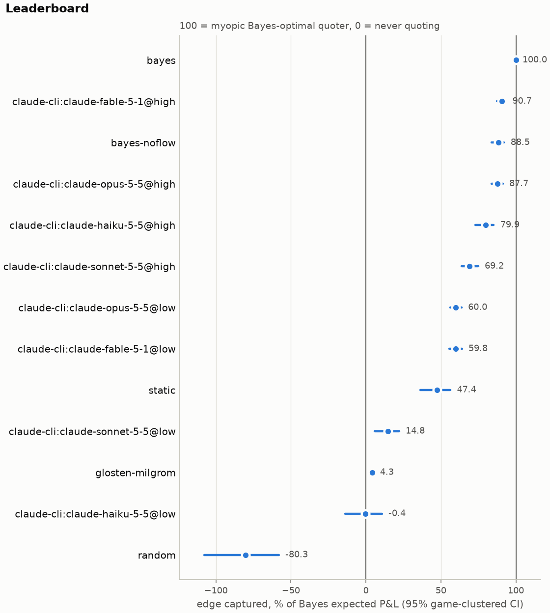
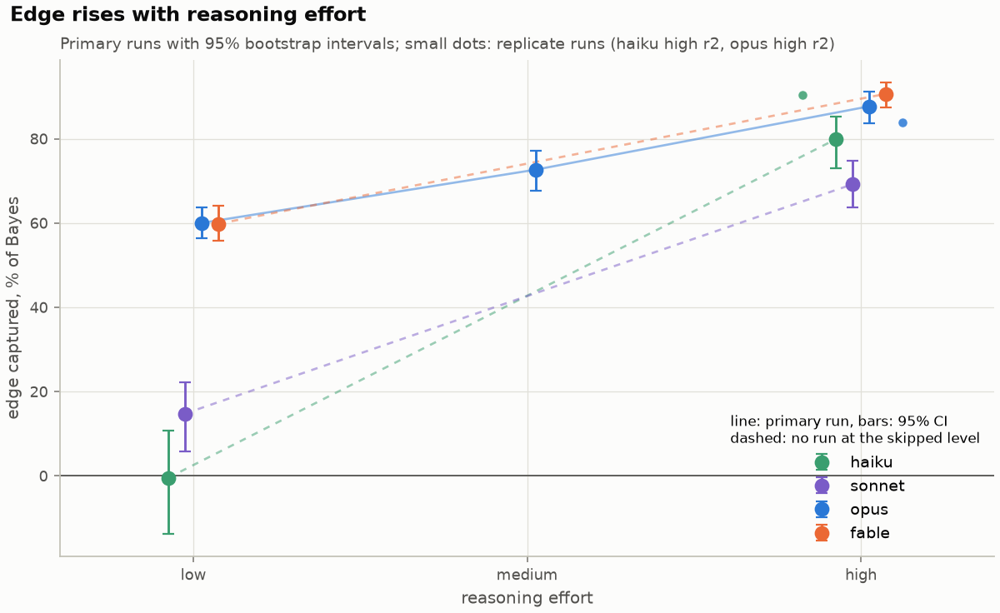
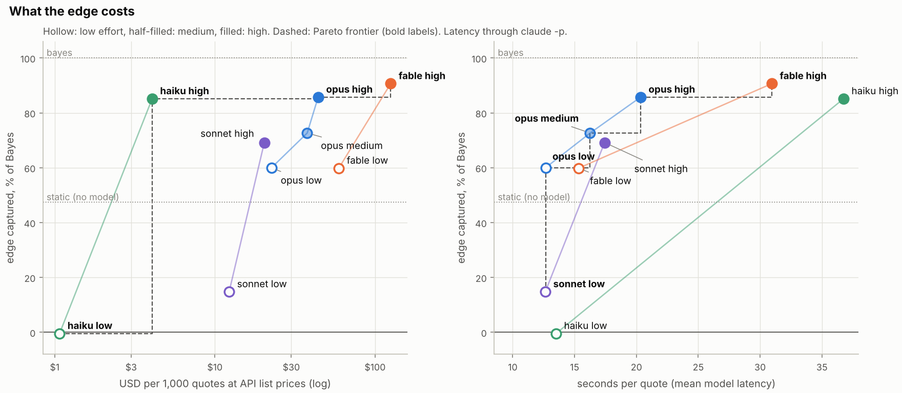
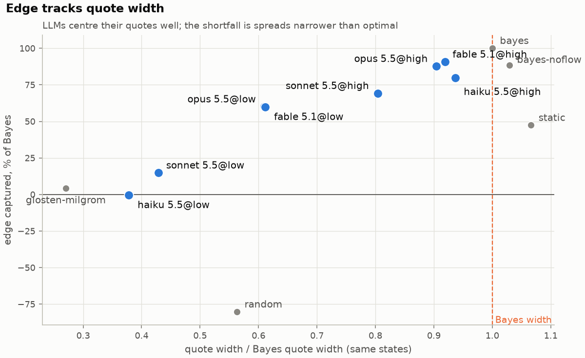
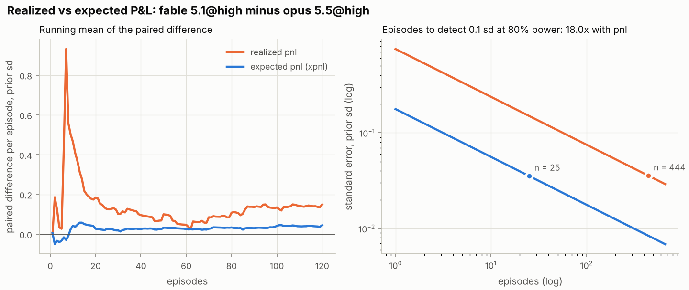
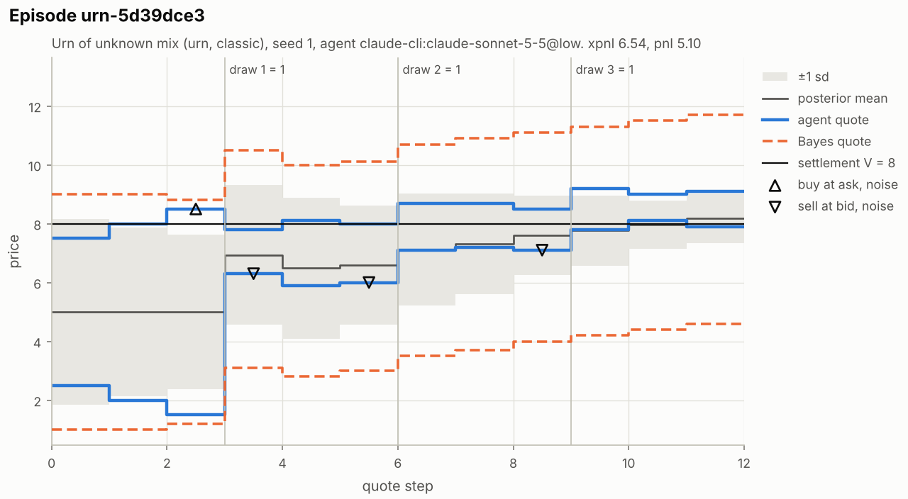

# mm-arena

[](https://github.com/h-a-forster/mm-arena/actions/workflows/ci.yml)
[](LICENSE)
[](pyproject.toml)

Market-making games as a benchmark for LLM agents, scored exactly against a Bayes-optimal quoter.

"Make me a market on the sum of three dice" is a standard trading-interview game. You quote a bid
and an ask, information arrives, some counterparties know more than you, and you settle at the
true value. Doing it well takes two skills: updating a belief from reveals *and from who trades
with you*, and pricing the risk of trading against someone better informed (adverse selection).

mm-arena puts an LLM in the market maker's seat. The hidden state is small enough to enumerate,
so the simulator knows the exact public posterior at every step. Every quote gets an exact
expected value, and every agent is compared with a Bayes-optimal quoter on the same dice and the
same counterparties.

## Findings

- **Reasoning effort matters most.** Raising effort from low to high lifts Haiku 5.5 from 0% to
  80% of the Bayes edge, Sonnet 5.5 from 15% to 69%, Opus 5.5 from 60% to 88% and Fable 5.1 from
  60% to 91%. Opus rises through medium (73%; that run used a newer Claude Code, and within
  that version high is still +11.1 points above medium). See [Effort curve](#effort-curve).
- **Low effort loses on width; at high effort width and centring both matter.** At low
  effort Sonnet's quotes are centred well enough: giving it the Bayes width alone lifts it from
  16% to 89%. At high effort Fable gains 4.8 points from the Bayes width and 3.3 from the Bayes
  centre; Opus 6.7 and 3.1. See [Centring vs width](results/core-v1/REPORT.md#centring-vs-width).
- **The best models at high effort match simple posterior-based quoters, and the myopic reference
  is near-optimal.** Fable and Opus at high effort are statistically indistinguishable from
  `bayes-noflow` (88.5) and from `bayes-mean` (86.3, exact mean with a fixed spread multiple).
  One-step lookahead scores 100.8 [100.2, 101.5], so the reference leaves under about 1% at that
  horizon (a lower bound on headroom). See [Reference quoters](#reference-quoters) and
  [What the numbers say](#results).
- **Scores moved between runs by as much as the gaps between the top setups.** A second Opus
  5.5 @high run scored 3.9 points lower and a second Haiku 5.5 @high run 10.5 points higher. The
  second runs also used a newer Claude Code that sends the model about 600 more prompt tokens per
  quote, so the shift mixes run-to-run noise with a change of setup and the design cannot
  separate them. Either way, gaps of a few points between top setups are not settled by one run.
  Fable 5.1 @high was not replicated, so its 3-point lead over Opus rests on one run. See
  [Run-to-run variability](#run-to-run-variability).
- **Realized P&L would not rank these models.** Separating Fable from Opus at high effort takes
  about 18 times as many episodes with realized P&L as with expected P&L. See
  [REPORT.md](results/core-v1/REPORT.md#variance-realized-vs-expected-pl).

## Results

`core-v1`: 60 games (5 families, classic and perturbed), 2 episodes each, the same 120 episodes
for every agent. Claude 5.5 and Fable 5.1 models via Claude Code headless mode (`claude -p`, no
tools), October 2026. 95% intervals from a bootstrap over games. 0 invalid replies and 0 provider
errors in 9,460 LLM quotes (11 runs of 860). The Opus 5.5 @medium run and the two replicates
used Claude Code 2.1.296; the original eight runs used an earlier version (not recorded in the
traces). The newer version changes the answering model's input: about 600 more prompt tokens per
quote (median +594 for Opus @high, +629 for Haiku @high, same step of the same episode), on top
of a separately recorded auxiliary Haiku call. Treat comparisons across the two versions as
comparisons of slightly different setups.



| agent | edge captured % [95% CI] | width / Bayes | adverse / episode | β flow | β reveal | classic − perturbed | output tokens / quote |
| --- | ---: | ---: | ---: | ---: | ---: | ---: | ---: |
| `bayes-lookahead` | 100.8 [100.2, 101.5] | 1.00 | 0.45 | 1.00 | 1.00 | -1.2 [-2.3, -0.4] | - |
| `bayes` | 100 | 1.00 | 0.41 | 1.00 | 1.00 | 0 | - |
| **fable 5.1 @high** | 90.7 [87.5, 93.3] | 0.92 | 0.54 | 1.03 | 0.99 | +1.4 [-5.3, +7.7] | 2,101 |
| `bayes-noflow` | 88.5 [83.9, 92.1] | 1.03 | 0.44 | 0.00 | 0.93 | -0.1 [-9.0, +9.0] | - |
| **opus 5.5 @high** | 87.7 [83.7, 91.2] | 0.90 | 0.55 | 0.98 | 1.03 | +2.3 [-6.9, +11.2] | 1,750 |
| `bayes-mean` | 86.3 [83.0, 89.0] | 1.06 | 0.39 | 1.01 | 0.98 | +2.5 [-4.3, +8.0] | - |
| **haiku 5.5 @high** | 79.9 [72.9, 85.2] | 0.94 | 0.53 | 0.30 | 0.91 | +4.8 [-16.3, +19.5] | 6,516 |
| **opus 5.5 @medium** | 72.7 [67.6, 77.1] | 0.77 | 0.68 | 1.03 | 0.96 | +6.7 [-4.8, +18.4] | 1,228 |
| **sonnet 5.5 @high** | 69.2 [63.8, 74.8] | 0.80 | 0.67 | 0.66 | 0.90 | +12.5 [-2.3, +25.5] | 1,620 |
| **opus 5.5 @low** | 60.0 [56.4, 63.7] | 0.61 | 0.83 | 0.84 | 0.94 | +9.6 [+1.8, +17.5] | 664 |
| **fable 5.1 @low** | 59.8 [55.7, 64.0] | 0.61 | 0.81 | 0.98 | 0.94 | -1.3 [-10.2, +6.8] | 752 |
| `static` | 47.4 [36.2, 56.3] | 1.07 | 0.56 | 0.00 | 0.00 | +4.9 [-18.5, +27.3] | - |
| **sonnet 5.5 @low** | 14.8 [5.8, 22.1] | 0.43 | 0.93 | 0.33 | 0.83 | +21.5 [+8.1, +35.7] | 757 |
| `glosten-milgrom` | 4.3 [3.7, 5.0] | 0.27 | 1.09 | 0.96 | 1.00 | +0.8 [-1.2, +2.8] | - |
| **haiku 5.5 @low** | -0.4 [-13.7, 10.7] | 0.38 | 0.93 | 0.17 | 0.87 | +17.0 [-25.7, +45.4] | 1,706 |
| `random` | -80.3 [-107.7, -58.1] | 0.56 | 0.77 | -0.02 | 0.15 | +20.5 [-38.3, +77.1] | - |

Edge captured: expected P&L as a share of the Bayes quoter's on the same episodes. Width,
adverse selection and β are defined under [Metrics](#metrics). `@low` / `@medium` / `@high` is the
reasoning-effort setting. The table shows each setup's first run; see
[Run-to-run variability](#run-to-run-variability).

The scale: 100 is the myopic Bayes quoter and 0 is never quoting. It is not anchored at a naive
quoter. `static` (prior mean ± one sd, never updated) already scores 47.4, `bayes-mean` 86.3 and
`bayes-noflow` 88.5. `glosten-milgrom`, the zero-profit competitive quote, scores 4.3. Scores above
100 are possible because the reference is myopic: `bayes-lookahead` scores 100.8.

The classic − perturbed intervals changed from the first publication. The bootstrap now resamples
hidden structures (the four classic games of a family share one, so 20 classic games are 5
structures), which widens them. Sonnet @high went from [+1.9, +22.5] to [-2.3, +25.5].

**What the numbers say**

1. **Reasoning effort matters most.** From low to high effort, Haiku 5.5 goes from 0% to 80% of
   the Bayes edge, Sonnet 5.5 from 15% to 69%, Opus 5.5 from 60% to 88% and Fable 5.1 from 60%
   to 91%. The jumps are +80.3 [72.3, 89.2], +54.4 [46.5, 63.2], +27.7 [23.9, 31.6] and +30.8
   [27.4, 34.2] points. All four are significant (paired test over games, Holm p = 0.012, the
   smallest the test can give across 16 agents; earlier versions of this README said
   p < 0.01). At high effort, Fable and Opus match `bayes-noflow`, which knows the exact posterior from reveals but
   ignores order flow: Fable − `bayes-noflow` is +2.1 [-2.1, 6.6] (Holm p = 1.0), Opus −0.8 [-4.8,
   3.3]. Fable leads Opus by 3.0 points [1.1, 5.2] in the first Opus run (Holm p = 0.04; it was
   0.02 before the Holm family grew from 13 to 16 agents). See
   [Run-to-run variability](#run-to-run-variability) for how far that lead can be trusted.
2. **At low effort the shortfall is spread width; at high effort width and centring both
   matter.** Mean signed mid error is at most 0.09 posterior sd for every model, so mids are
   unbiased on average. But mean absolute mid error is 0.23-0.46 sd (Bayes 0.07), and quotes are
   0.38-0.94 times as wide as the Bayes quote. Pricing the same posteriors with the Bayes width
   lifts Sonnet @low from 16 to 89; the Bayes centre lifts it only to 35. At high effort the two
   are comparable: Fable gains 4.8 from width and 3.3 from centring, Opus 6.7 and 3.1, Haiku 11.1
   and 7.8 ([Centring vs width](results/core-v1/REPORT.md#centring-vs-width); covered steps
   84-99%). At low effort Haiku and Sonnet quote at under half the Bayes width, closer to the
   zero-profit Glosten-Milgrom quote (0.27), and lose more than twice as much to informed traders
   as Bayes (0.93 vs 0.41 prior sd per episode).
   Most of the Bayes edge is monopoly spread from noise traders whose price sensitivity is
   disclosed (Bayes capture 1.92 vs adverse selection 0.41 prior sd per episode). Quoting tight
   may partly reflect a competitive-market habit, and `glosten-milgrom` is the competitive quote.
   See [methodology §3.1](docs/methodology.md).
3. **Two setups fall below a static quoter.** Sonnet (15%) and Haiku (0%) at low effort do
   worse than `static`, which quotes the prior mean ± one sd and never updates (47%).
4. **Order flow separates the top models.** Across consecutive steps within a stage (trades and
   quiet steps both carry information), Fable and Opus move their quotes about as far as the
   Bayes quoter does (β flow 0.84-1.03). Haiku at high effort reaches 80% with β flow 0.30: it
   quotes wide enough to survive informed traders but barely learns from them, like
   `bayes-noflow`. Every model handles public reveals well (β reveal 0.83-1.03).
5. **Token count does not explain it.** Haiku at low effort writes as many output tokens per
   quote as Opus at high effort (about 1,700) and captures no edge. At high effort Haiku writes
   about 6,500 per quote, 3.7 times as many as Opus, to reach 80%.
6. **Low-effort Sonnet and Opus lean towards textbook games, but this is suggestive only.**
   Sonnet @low scores 21.5 points higher on classic than perturbed games [8.1, 35.7] and Opus
   @low 9.6 [1.8, 17.5] (raw p 0.006 and 0.009). After Holm correction across the nine LLM setups
   neither is significant at 5% (0.054 and 0.072), and no other setup shows a gap. This fits
   recall, but textbook setups (standard dice, uniform priors) may also be easier to compute. The
   design does not separate the two.
7. **Realized P&L would not rank these models.** Detecting a difference of 0.1 prior sd per
   episode between Fable and Opus at high effort needs about 25 episodes with xPnL and about 444
   with realized P&L (18 times as many). For single LLM agents the ratio is 4-12. A leaderboard
   built on realized P&L from a few dozen episodes mostly measures luck.
8. **Top LLMs at high effort match a fixed-width quoter around the exact mean.** `bayes-mean`
   (exact posterior mean ± 1.40 posterior sd) scores 86.3 [83.0, 89.0]. Fable @high is +4.4
   [-0.1, 8.7] above it (Holm p = 0.53), Opus @high +1.4 [-4.0, 6.4]. The myopic reference is
   close to the best one-step policy: `bayes-lookahead` scores 100.8 [100.2, 101.5].

### Effort curve



Opus 5.5 is the only model run at three effort levels: low 60.0 [56.4, 63.7], medium 72.7 [67.6,
77.1], high 87.7 [83.7, 91.2]. Medium − low is +12.6 [8.8, 16.6] and high − medium +15.0 [12.5,
17.6], both Holm p = 0.012. Output grows with effort: 664, 1,228 and 1,750 tokens per quote. At
medium effort Opus's width is 0.77 of the Bayes width, its adverse selection is 0.68 and its β
flow is 1.03, so it already reads order flow and still quotes too tight. Medium ran on the
newer Claude Code and high (run 1) on the older one. Within the newer version, high (run 2)
minus medium is +11.1 [7.6, 14.7], so the curve rises either way, but the +15.0 step mixes in the
version change. Medium costs $37.70
per 1,000 quotes at 16.3 s per quote ([Cost](#cost)).

### Run-to-run variability

Only Opus 5.5 @high and Haiku 5.5 @high have a second run. Both were scored on the same games and
seeds as the first.

| setup | run | edge captured % [95% CI] | minus run 1, pp [95% CI] |
| --- | --- | ---: | ---: |
| opus 5.5 @high | run 1 | 87.7 [83.7, 91.2] | - |
|  | run 2 | 83.8 [79.8, 87.8] | -3.9 [-6.8, -1.2] (p 0.008) |
|  | pooled | 85.7 [81.9, 89.3] | - |
| haiku 5.5 @high | run 1 | 79.9 [72.9, 85.2] | - |
|  | run 2 | 90.4 [87.8, 92.5] | +10.5 [6.2, 16.1] (p < 0.001) |
|  | pooled | 85.1 [80.8, 88.6] | - |

- **The Opus 5.5 @high replicate moved by 3.9 points. Fable 5.1 @high was not replicated**, so
  its 3-point lead over Opus @high rests on one run. Since Opus moved by more than 1 point
  between runs, the Fable lead is less certain than its interval suggests. Fable also leads
  Opus's second run (+6.9 [4.1, 9.9]) and the pooled Opus (+4.9 [2.9, 7.1], p < 0.001), but that
  does not test Fable's own stability.
- **Haiku moved by 10.5 points.** In run 2 it wrote more (8,634 output tokens per quote against
  6,516) and its cards score was 80.4 against 43.8 in run 1. Its other families, run 1: coin
  87.7, dice 76.6, transform 91.1, urn 85.9; run 2: coin 94.6, dice 88.3, transform 93.1, urn
  91.3. Haiku @high is the least stable top setup.
- **Pooled, Opus and Haiku at high effort are indistinguishable:** Opus − Haiku is +0.6 [-4.1,
  5.7] (p 0.83). Run against run their order flips: run 1 against run 1 is +7.8 [1.8, 15.1], run
  2 against run 2 is -6.6 [-11.0, -2.2].
- **Confound.** The replicates differ from the originals in date, server state and Claude Code
  version, and the newer version sends the answering model about 600 more prompt tokens per
  quote (see [Results](#results)). The shifts are systematic rather than scattered: Haiku run 2
  beat run 1 on 45 of 60 games, and Opus run 2 trailed run 1 on 42 of 60. That points at least
  partly to the setup change, but the design cannot separate it from drift. The game
  bootstrap covers sampling across games within a run, not this drift.

Haiku @high against Sonnet @high in run 1 is +10.7 [3.1, 17.5], p 0.009, Holm 0.13: not
significant after correction.

### Cost

What each setup costs per quote at API list prices, against the edge it captures. The dashed
line is the Pareto frontier: no other setup is both cheaper (or faster) and better.



| setup | runs | edge captured % | USD / 1,000 quotes | USD / 1,000 quotes, 5-min writes | USD / core-v1 run | seconds / quote | cost frontier | latency frontier |
| --- | ---: | ---: | ---: | ---: | ---: | ---: | :---: | :---: |
| haiku 5.5 @low | 1 | -0.4 | 1.07 | 0.99 | 0.92 | 13.5 | yes | |
| haiku 5.5 @high | 2 | 85.1* | 4.06 | 3.96 | 3.49 | 36.7 | yes | |
| sonnet 5.5 @low | 1 | 14.8 | 12.27 | 10.53 | 10.55 | 12.6 | | yes |
| sonnet 5.5 @high | 1 | 69.2 | 20.36 | 18.83 | 17.51 | 17.4 | | |
| opus 5.5 @low | 1 | 60.0 | 22.59 | 19.14 | 19.43 | 12.7 | | yes |
| opus 5.5 @medium | 1 | 72.7 | 37.70 | 32.83 | 32.42 | 16.3 | | yes |
| opus 5.5 @high | 2 | 85.7* | 44.13 | 40.18 | 37.95 | 20.3 | yes | yes |
| fable 5.1 @low | 1 | 59.8 | 59.34 | 51.25 | 51.03 | 15.3 | | |
| fable 5.1 @high | 1 | 90.7 | 125.16 | 117.70 | 107.64 | 30.9 | yes | yes |

\* Setups with two runs show the pooled edge and the pooled cost and latency. USD per core-v1 run
is 0.86 times USD per 1,000 quotes. "5-min writes" prices every cache write as a 5-minute write,
the API default.

- **Haiku at high effort is the value pick.** Pooled over two runs it captures 85.1% of the Bayes
  edge, against 85.7% for pooled Opus @high, at about 1/11 of the price ($4.06 against $44.13 per
  1,000 quotes). The difference is not significant. Sonnet @low, Sonnet @high, Opus @low, Opus
  @medium and Fable @low cost 3.0-14.6 times as much and score lower. For Haiku @high against
  Sonnet @high the gap in run 1 (+10.7 [3.1, 17.5]) is not significant after Holm correction
  (p = 0.13). Haiku @high is also the least stable top setup (+10.5 points between runs).
- **The last steps up the frontier cost more per point.** Fable @high is +4.9 [2.9, 7.1] over
  pooled Opus @high for 2.8 times the price, about $17 per point per 1,000 quotes. Fable was not
  replicated ([Run-to-run variability](#run-to-run-variability)). It pays only where the last few
  points matter more than cost.
- **Latency ranks the setups differently.** Haiku at high effort is the slowest (36.7 s per quote
  pooled; it writes about 6,500-8,600 tokens per answer). The latency frontier is Sonnet @low,
  Opus @low, Opus @medium, Opus @high and Fable @high. Opus at high effort reaches 85.7% at 20.3
  s per quote, and Opus at low effort 60% at 12.7 s. The Opus @high replicate partly overlapped
  with CPU-heavy jobs on the same machine, which may inflate its CLI start-up time.

Costs are the list prices of the tokens each call used (`mmarena.pricing`, prices as of
2026-10-10). On a subscription the cost is usage limits, not dollars. Notes:

- Costs price Claude Code's cache writes as 1-hour writes. Claude Code 2.1.296 reports every
  write as 1-hour, and traces now record `cache_write_1h_tokens`. With the API's default 5-minute
  writes the same tokens cost up to about 15% less at low effort (Opus @low $22.59 to $19.14 per
  1,000 quotes). The frontier does not change.
- Claude Code 2.1.296 adds a small auxiliary Haiku call per request (about 1.6k input tokens). It
  is recorded in traces but excluded from these costs (about $0.18 per core-v1 run). The same
  version also sends the answering model about 600 more prompt tokens per quote, which adds
  cache writes worth about $4.8 per 1,000 Opus quotes, so costs for runs on 2.1.296 (Opus
  @medium, the replicates) are not exactly like-for-like with the original runs. The frontier
  does not change.
- The `anthropic:` provider's default `max_tokens` is 8192, but 198 of 860 Haiku @high replies
  (run 1) used more output tokens (maximum 43,375). To reproduce through the API, pass
  `--max-tokens 64000`.
- Latency is the provider-reported time per quote through `claude -p`, with CLI start-up and four
  calls in parallel.
- Claude Code's own cost field priced Haiku 5.5 at Opus rates, 40 times too high; mm-arena costs
  runs from token counts instead.

Full report: [results/core-v1/REPORT.md](results/core-v1/REPORT.md). Traces for every episode
are in [results/core-v1/](results/core-v1/); `mm-arena report results/core-v1` rescores them.





One episode, Sonnet 5.5 at low effort on the classic urn game. After the first draw its quotes
(blue) hug the posterior mean; the Bayes quotes (orange, dashed) are almost three times as wide
overall. Expected profit of its quotes: 6.5. The Bayes quoter, from the same states: 15.2.



## How it works

```
hidden state ω (dice, cards, coin bias, urn)      contract settles at V(ω)
stage 1: quote, quote, quote  ->  reveal die 1  ->  stage 2: quote, quote, quote  ->  ...  settle
each quote: one counterparty arrives
   informed (prob α): knows V, buys if V > ask, sells if V < bid
   noise (prob 1-α):  values at fair value + N(0, s), same rule
```

- **Exact posterior.** Outcomes are enumerated (at most 250k, usually a few hundred). Reveals and
  fills (and quiet steps) update the posterior by Bayes' rule under the disclosed trader model.
- **Exact score per quote.** For every quote, the simulator computes its expected one-step profit
  given public information, split into spread *capture* and *adverse* selection.
- **xPnL, not P&L.** The headline score sums those expectations along the path the agent played.
  It has the same expectation as realized P&L but strips out the luck of who arrived and what
  the dice were, the same idea as luck-adjusted scoring in poker (DIVAT, AIVAT).
- **Common random numbers.** The hidden outcome and every counterparty draw depend only on
  `(game, seed)`. All agents face identical episodes; comparisons are paired.
- **Contamination probe.** Each family has a *classic* variant (three standard dice, a 52-card
  deck) and *perturbed* variants generated per seed (odd dice, custom decks, unusual contracts).
  A model that does better on classic than perturbed games may be recalling rather than
  reasoning.

Details, formulas and limitations: [docs/methodology.md](docs/methodology.md).

### Reference quoters

| agent | what it does |
| --- | --- |
| `bayes` | exact posterior, quote maximising one-step expected profit. The 100 mark. |
| `bayes-noflow` | same, but ignores what trades reveal. The gap measures learning from order flow. |
| `bayes-mean` | exact posterior mean ± 1.40 posterior sd (k tuned on a separate seed set). Exact centre, one fixed width rule. |
| `bayes-lookahead` | exact posterior, one-step lookahead. Shows how much the myopic 100 mark leaves. |
| `glosten-milgrom` | exact posterior, zero-profit quote `ask = E[V \| buy]`. A tight market is not a profitable one. |
| `static` | prior mean ± one prior sd, never updated. |
| `random` | random quotes around the prior. |

### Game families

| family | hidden state | contract | classic variant |
| --- | --- | --- | --- |
| `dice` | 2-4 dice, custom faces, some loaded | sum | three d6 |
| `cards` | 2-3 cards from a custom deck | sum | three cards from a 52-card deck |
| `transform` | dice or cards | max, min, range, product, count above a threshold | product of two d6 |
| `coin` | coin picked from a set of biases, n flips | heads (times a multiplier) | fair or double-headed coin |
| `urn` | urn with an unknown number of red balls | red balls in the urn | uniform prior, 10 balls |

## Install

```sh
uv tool install "mm-arena[all] @ git+https://github.com/h-a-forster/mm-arena"
# or
pip install "mm-arena[all] @ git+https://github.com/h-a-forster/mm-arena"
```

Python 3.11+. The only required dependency is numpy. Extras: `anthropic`, `openai`, `plot`
(matplotlib), `all`.

## Quick start

Baselines need no API key and finish in seconds:

```sh
mm-arena run --agent bayes --agent static --agent glosten-milgrom --suite core-v1
mm-arena report runs/core-v1
```

Run a model:

```sh
export ANTHROPIC_API_KEY=...
mm-arena run --agent anthropic:claude-sonnet-5-5@low --suite core-v1 --limit 1

export OPENAI_API_KEY=...
mm-arena run --agent openai:gpt-5.1 --suite core-v1

# any OpenAI-compatible server: vLLM, Ollama, LM Studio, OpenRouter
mm-arena run --agent "openai:qwen3:8b@http://localhost:11434/v1" --suite smoke

# Claude Code headless mode, using the local login
mm-arena run --agent claude-cli:claude-opus-5-5@low --suite core-v1 --limit 1

mm-arena report runs/core-v1
```

Play it yourself, then get a step-by-step comparison with the Bayes quoter:

```sh
mm-arena play --family dice --variant classic
```

Other commands:

```sh
mm-arena prompt --family coin --seed 3     # the exact prompt an LLM sees
mm-arena games --suite core-v1             # list games
mm-arena show runs/core-v1/bayes.jsonl --episode 3 --plot ep.png
mm-arena suites
```

### Agent specs

| spec | meaning |
| --- | --- |
| `bayes`, `bayes-noflow`, `bayes-mean`, `bayes-lookahead`, `glosten-milgrom`, `static`, `random` | reference quoters |
| `anthropic:MODEL[@EFFORT]` | Anthropic Messages API (`ANTHROPIC_API_KEY`) |
| `openai:MODEL[@BASE_URL][@EFFORT]` | OpenAI or any compatible server (`OPENAI_API_KEY`, `OPENROUTER_API_KEY` for openrouter.ai) |
| `claude-cli:MODEL[@EFFORT]` | `claude -p` with no tools, no MCP, no settings |
| `scripted:TEXT` | fixed reply, for tests |

Runs are resumable: rerunning the same command skips finished episodes. Replies are cached in
`.mmarena-cache/`, keyed by the full request plus game, episode and attempt, so a rerun or a
rescore costs nothing (and a replicate needs `--no-cache`). Provider failures (auth, rate
limits, outages) exclude the episode instead of scoring it.

## Metrics

| metric | meaning | ideal |
| --- | --- | --- |
| edge captured | `100 · Σ xPnL / Σ xPnL(bayes)` on shared episodes | 100 |
| xPnL/sd, PnL/sd | expected and realized P&L per episode, in prior sd of the value | high |
| width / Bayes | quote width relative to the Bayes quote at the same state | ~1 |
| adverse | expected loss to informed traders per episode | low |
| mid abs z | distance of the quote mid from the posterior mean, in posterior sd | ~0 |
| β flow, β reveal | how much the mid moves per unit of Bayes-optimal move, after trades and quiet steps within a stage (order flow), and across reveals | 1 |
| dominated | quotes that lose for sure if hit (bid above the highest possible value) | 0 |
| invalid | unparseable or crossed replies | 0 |

## Suites

| suite | games | episodes | use |
| --- | --- | --- | --- |
| `smoke` | 5 | 5 | CI, quick checks |
| `core-v1` | 60 | 120 | the leaderboard |
| `full-v1` | 160 | 480 | tighter intervals |

Suites are versioned. A generator change that alters any game ships as a new suite version.

## Reproduce

```sh
git clone https://github.com/h-a-forster/mm-arena && cd mm-arena
uv sync --all-extras --dev
uv run pytest
uv run mm-arena run --suite core-v1 --out runs/core-v1   --agent bayes --agent bayes-noflow --agent bayes-mean --agent bayes-lookahead --agent glosten-milgrom --agent static --agent random
for model in claude-haiku-5-5 claude-sonnet-5-5 claude-opus-5-5 claude-fable-5-1; do
  for effort in low high; do
    uv run mm-arena run --agent claude-cli:$model@$effort --suite core-v1 --out runs/core-v1
  done
done
uv run mm-arena run --agent claude-cli:claude-opus-5-5@medium --suite core-v1 --out runs/core-v1
# a replicate (stored as agent#r2); see below
uv run mm-arena run --agent claude-cli:claude-opus-5-5@high --name 'claude-cli:claude-opus-5-5@high#r2' --suite core-v1 --out runs/core-v1
uv run mm-arena report runs/core-v1
uv run python scripts/figures.py runs/core-v1 docs/figures
```

The response cache key holds the provider, model, options, `max_tokens`, prompts and a salt (game,
episode, attempt), not the agent name. A replicate therefore needs an empty cache or `--no-cache`;
otherwise it replays the first run's replies.

## Open questions

1. **What drives run-to-run drift?** Opus @high moved 3.9 points and Haiku @high 10.5, but the
   replicates also changed Claude Code version. Re-run with the same CLI version
   (`mm-arena run --name 'claude-cli:...@high#r3'`, with `--no-cache`) and compare in the
   Run-to-run section of `src/mmarena/report.py`. Fable @high needs a replicate first.
2. **Why did Haiku @high collapse on cards in run 1 but not run 2?** Cards scored 43.8 against
   80.4. Read the traces in `results/core-v1/claude-cli_claude-haiku-5-5@high*.jsonl` and
   inspect single games with `mm-arena show ... --game ID`.
3. **Do LLMs quote tight from a competitive-market prior?** Try a prompt that names the monopoly
   setting (`src/mmarena/agents/prompt.py`). It needs a new prompt version and so a new suite
   version.
4. **Recall or computation on classic games?** The low-effort classic advantage is suggestive
   only. Use perturbed variants matched for difficulty (`src/mmarena/games/families.py`).
5. **How much headroom is there beyond one step?** `bayes-lookahead` gains under about 1%. Start
   from `scripts/headroom.py` and `LookaheadAgent` in `src/mmarena/agents/baselines.py`.
6. **Does learning from order flow matter at a fixed width?** Compare agents with matched widths
   using `src/mmarena/decompose.py`.

## Limitations

- Stylised market: one counterparty per step, unit size, informed traders see the value
  exactly, noise traders value around the exact public mean.
- The reference is myopic. It does not value the information a quote generates, so a score
  above 100 is possible. One-step lookahead scores 100.8, so the myopic reference leaves under
  about 1% at that horizon; a deeper horizon could add more.
- The trader model is disclosed in full. The benchmark measures reasoning under a known model,
  not estimating one.
- Most of the Bayes edge is monopoly spread, so a model that quotes tight from competitive-market
  habit is penalised here.
- LLM scores depend on the prompt and provider settings. The prompt is fixed for a suite
  version, and the provider spec is in each run's file name, but traces do not record the
  Claude Code version or what it adds to the prompt (see [Results](#results)).
- Sampling noise across games is in the bootstrap. Run-level drift is not. Second runs moved by
  4 and 10 points, but they also changed Claude Code version and with it the model's input, so
  pure drift may be smaller. Only Opus @high and Haiku @high were replicated; Fable was not.

## Related work

Builds on Glosten and Milgrom (1985) for the market model and on DIVAT/AIVAT for luck-adjusted
evaluation. Unlike LLM trading benchmarks that score realized P&L on market data (StockBench,
InvestorBench, Alpha Arena), it measures belief updating and adverse-selection pricing where the
optimal answer is known. See [docs/related-work.md](docs/related-work.md).

## Citation

```bibtex
@software{mm_arena,
  title  = {mm-arena: market-making games as a benchmark for LLM agents},
  author = {{h-a-forster}},
  year   = {2026},
  url    = {https://github.com/h-a-forster/mm-arena}
}
```

## License

MIT
